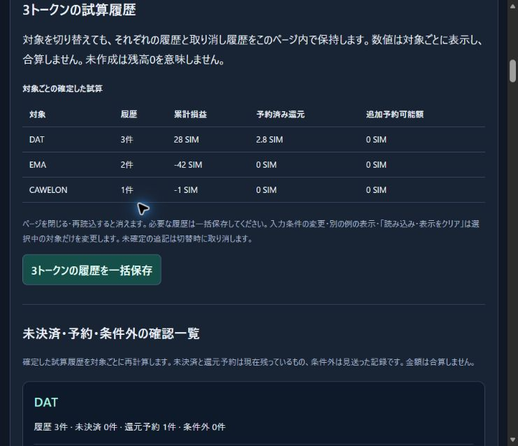

# Browser control recovery — October 30, 2026

The existing Edge rehearsal tab was successfully reclaimed through the normal browser-extension interface in the next user turn. Its current URL and visible DOM were available again. No native-app fallback, permission change, browser-security override, forced server restart or origin-header substitution was used.

The page still contained DAT 3 records, EMA 2 records, CAWELON 1 record and three comparison cases. Actual UI interaction filtered the record list to EMA (2 of 6) and reset it to all records (6 of 6). The original tab was retained without reload. NEC1961 was also reported online by Desktop Commander; that device status is separate from browser-tab controllability.

[Observed page state](evidence/2026-10-30-control-recovery/browser-state.json).

For the subsequent source verification, the existing page's “まとめて保存・復旧” link was opened normally in a new tab. Although that click reported a command timeout, tab discovery showed that the new rehearsal had opened, so the click was not repeated. The new tab loaded the current modules, accepted the original saved session through the reviewed paste workflow, and downloaded a new combined file. Its exact bytes matched the original. The latest verified tab is retained as the working rehearsal; the original remains available.

The previous `waitForEvent('download')` timeout is avoided in this workflow: the UI save action is followed by a page-state check and direct examination of the produced local file. A “save started” message alone is not treated as proof of disk completion. This is a supported ordinary browser/file workflow, not circumvention of the previous Computer Use stop.

The observed recovery does not establish the root cause of the earlier debugger detachment or guarantee that the extension will remain connected. The existing server process on port 4231 was not restarted, and the separate server-side navigation-help update remains unloaded there. The new rehearsal source modules are served from disk and can be loaded in a fresh normal page.

Official reference consulted: [Browser extension](https://learn.chatgpt.com/docs/chrome-extension), [Browser](https://learn.chatgpt.com/docs/browser). These document the supported browser interfaces; they do not specifically diagnose this session's failure.

All records shown here are fictional rehearsal inputs. No signature, transfer, approval, private key or production deployment was involved. Routine reconnection is not counted as another development feature.
