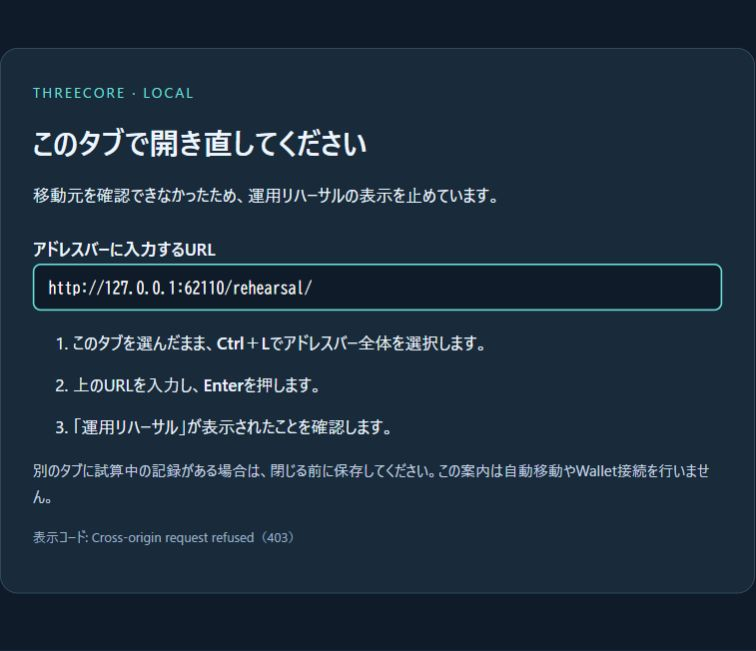

# Local navigation help — items 164–166

Source: `d374f07` (local only).

164. Add a passive Japanese explanation to a refused top-level navigation to `/` or `/rehearsal/`. The page provides the exact loopback address and ordinary address-bar steps without automatically navigating or connecting a wallet.
165. Verify that the help preserves the original 403 response, no-store policy, origin/host checks and RPC boundaries. The displayed URL uses the server's local port and a fixed route; request host, origin, referrer and arbitrary path/query input are never reflected. **20 related tests passed, zero failed**.
166. Verify the actual Edge rendering on an isolated local server, save the screenshot and DOM observation, close that temporary tab/server, and preserve the original rehearsal tab and its restored records.

```powershell
node --test --test-concurrency=2 integration/local-navigation-help.test.mjs integration/demo-server.test.mjs integration/operation-rehearsal-server.test.mjs integration/base-state-rpc-server.test.mjs
```

[Test log](evidence/2026-10-30-navigation-help/navigation-tests.log), [browser observation](evidence/2026-10-30-navigation-help/browser-help-observation.json), [checksums](evidence/2026-10-30-navigation-help/SHA256SUMS.txt).



The screenshot used temporary port 62110, which has since been closed. The browser observation shows a read-only address field, zero script elements, and no horizontal overflow at the observed 756-pixel viewport. The existing rehearsal remains at port 4231.

Restarting the existing 4231 server was rejected by automatic approval review with only “blocked by policy” as the reason. No stop/restart was executed. Instead, a separate loopback-only server loaded the current source for this verification and was gracefully closed afterward. Therefore the new server-side help is implemented and verified, but is **not loaded into the already-running 4231 process**. Its original rehearsal tab was not reloaded or replaced.

This is application guidance for an application-generated 403, not a browser-security bypass or a change to access permissions. Direct address-bar navigation remains the supported entry path. All tests use local fixtures; no live RPC, signature, transfer, approval or private-key access occurred.
