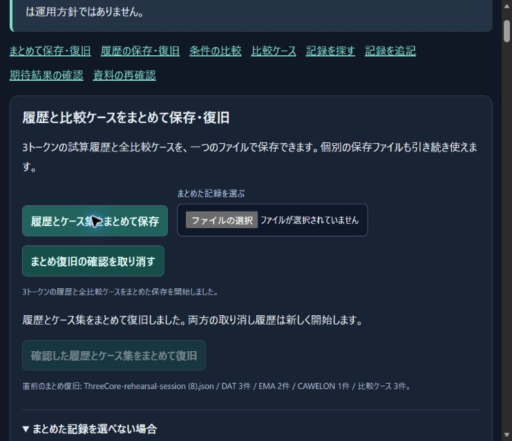

# Native Edge file import verified

On October 30, 2026 (Asia/Tokyo), the user reported enabling the ChatGPT extension's file-URL access and selected the existing rehearsal tab. The agent then recovered the normal Microsoft Edge extension connection and performed the complete native file workflow on that selected tab. No browser setting was changed by the agent and no rejected internal-settings navigation was retried.

1. Selected `C:/Users/aseet/Downloads/ThreeCore-rehearsal-session (8).json` with the supported file chooser.
2. Observed the file name as the review source, a preview from zero to three recorded subjects and from zero to three comparison cases, and an enabled restore button.
3. Confirmed restoration and observed DAT 3, EMA 2, CAWELON 1 and three comparison cases in the restoration receipt.
4. Downloaded a new combined session through the save button.
5. Independently compared `ThreeCore-rehearsal-session (9).json` with the selected original and inspected the downloaded file with the existing offline verifier.

Both files are **17,387 bytes**, with SHA-256 **`22c7909969a4221d443d8452cefb4e147fa796782f9ef7ce50462cb6ea4d8f9c`**. Their exact byte sequences match. File existence and byte comparison, rather than the UI's save-started message, establish the completed download.

The selected page remains open at `http://127.0.0.1:4231/rehearsal/#session-title`. Other rehearsal tabs were not replaced or reloaded. The connection initially required recovery after the extension session changed; the successful workflow did not require another permission request, a native desktop fallback, or a server restart. An earlier file-chooser wait had timed out; that attempt is not counted as a completed import.

This verifies the previously unresolved **native file-selection and import path**. It uses fictional rehearsal data and does not establish on-chain balances, production readiness or safety of the tokens. No source code changed for this verification, no signature or financial transaction was requested, and no secret was retrieved. The development tally remains 178/600; routine reconnection and repetition do not add items.

[Observed browser state](evidence/2026-10-30-native-file-import/browser-state.json), [exact-byte comparison](evidence/2026-10-30-native-file-import/file-round-trip.json), [actual downloaded session](evidence/2026-10-30-native-file-import/edge-session.json), [offline inspection](evidence/2026-10-30-native-file-import/session-inspection.json), [checksums](evidence/2026-10-30-native-file-import/SHA256SUMS.txt).

