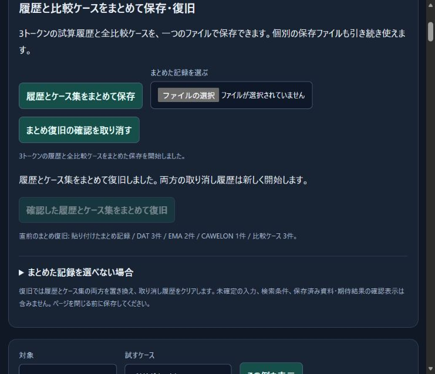

# Rehearsal download lifecycle — items 170–174

Source: `96abefd4879c8b4642e3fcf10b328bbcec4d46aa` (local only).

170. Prevent a synchronous download adapter from overwriting newer UI state after cancellation, input replacement or panel disposal. All sixteen download formats in seven panels check the revision after delivery and before reporting either success or failure.
171. Reproduce the stale-status defect and verify disposal/cancellation with both successful and refused delivery across all sixteen formats. The related suite passed **351 tests, zero failures**, including the new 64-case lifecycle matrix.
172. Complete the applicable full wallet suite at the fixed source revision above: **12,778 tests passed, zero failures, cancellations or skips**, across 390 files. No source was changed during this run. The separate token-contract compatibility harness is excluded because it requires a compiled token checkout. The exact scope is recorded; the earlier incorrectly scoped attempt remains documented separately.
173. Load the revised modules in a fresh normally opened Edge tab, restore the original six fictional records and three cases, and perform a real combined download. The resulting 17,387-byte file exactly matches the original SHA-256 `22c7909969a4221d443d8452cefb4e147fa796782f9ef7ce50462cb6ea4d8f9c`. This verifies the new revision, without treating a UI message as proof of a file write.
174. Add `npm run test:wallet` to reproduce the applicable suite with bounded concurrency, avoiding the incompatible token harness and Windows command-line length limit. Its file selection was compared with the 390-file recorded scope. This command-only change follows the full run; no claim is made that the source commit containing this script was itself used for that run.

[Reproduction](evidence/2026-10-30-download-lifecycle/before-fix.log), [related validation](evidence/2026-10-30-download-lifecycle/after-fix.log), [full validation](evidence/2026-10-30-download-lifecycle/full-suite.log), [scope](evidence/2026-10-30-download-lifecycle/full-suite-scope.json), [command selection](evidence/2026-10-30-download-lifecycle/command-scope.json), [downloaded session](evidence/2026-10-30-download-lifecycle/edge-session.json), [offline inspection](evidence/2026-10-30-download-lifecycle/session-inspection.json), [checksums](evidence/2026-10-30-download-lifecycle/SHA256SUMS.txt).

Normal browser control was also [recovered and exercised](CONTROL_RECOVERY_2026-10-30.md); routine reconnection is not counted as an additional feature. No signature, transfer, approval, private key, live chain request or deployment was involved. Test counts and this development ledger are not mainnet-readiness percentages.
