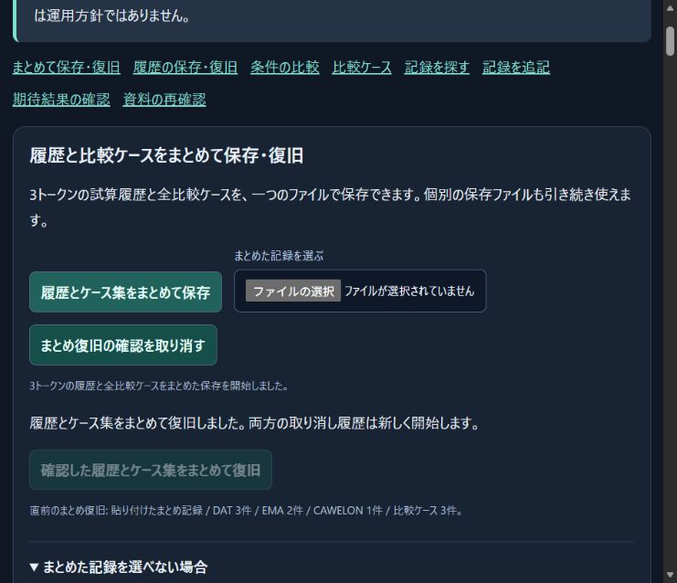

# Rehearsal file reading — items 175–178

Source: `809378aff5a73c305b067712bebb8db2d9775782` (local only).

175. Add a view-owned file reader using the existing page-wide admission and deadline service. Replacing or cancelling a view rejects its own waiting read promptly. It does not cancel unrelated readers. A late old completion cannot detach a newer reader's cancellation controller.
176. Route all six rehearsal file inputs through the bounded byte reader: single-token input, workspace, combined session, comparison collection, expected outcomes and saved-report review. Native File streams are supported; fallback byte counts must match the declared size. UTF-8 decoding is strict and a BOM is preserved for the existing format parser to reject. No file is silently repaired or partially applied.
177. Tie reader cancellation to the existing reset, edit, replacement and disposal paths, and update busy indicators for single-token and collection reading. Workspace failures now distinguish timeout, concurrent-reader capacity, malformed encoding and inconsistent file length. Normal reading has the existing 30-second deadline and four-worker page limit. Cancellation releases the waiting UI, but a still-running worker retains its reservation until it actually settles; repeated cancellation cannot create unbounded background work.
178. Verify the integrated behavior with real File streams, all six formats, malformed bytes, BOMs, size mismatches, fake buffers, oversize inputs, cancellation before/after worker startup, independent scopes, deadlines and shared capacity. **57 new tests** cover these behaviors. The broader rehearsal/file-reader set passed **1,429 tests, zero failures**. The full wallet regression result is recorded below. Existing source, undo and combined-session behavior remain covered.

The main single-token and workspace imports previously used `File.text()`, which replaces malformed UTF-8 and does not provide the existing byte-reader cancellation/deadline controls. The four auxiliary import panels decoded bytes strictly but did not use the shared read budget or stop their waiting read on reset. This change uses the already established service instead of introducing another independent timeout or retry loop.

## Validation and actual browser behavior

The related command was:

```powershell
node --test --test-concurrency=2 test/operation-rehearsal*.test.js test/file-read-*.test.js test/security-file.test.js integration/operation-rehearsal-server.test.mjs
```

[Related test log](evidence/2026-10-30-rehearsal-file-reading/related-tests.log), [full-suite scope](evidence/2026-10-30-rehearsal-file-reading/full-suite-scope.json), [full-suite log](evidence/2026-10-30-rehearsal-file-reading/full-suite.log).

The source stayed fixed during `npm run test:wallet`, which selects 391 applicable wallet/server test files and excludes the separate token-contract compatibility harness. Full-suite outcome: **12,835 tests passed; zero failures, cancellations or skips**.

A fresh Edge page loaded the updated modules from the existing local server. The actual automated file-selection attempt was refused because the ChatGPT extension does not currently have “Allow access to file URLs.” No extension permission was changed. The user subsequently explicitly authorized enabling that setting. The attempt to open `edge://extensions/` was rejected by the browser tool URL policy, which permits only HTTP and HTTPS and explicitly prohibits alternate automation routes for the blocked action. No alternate route was attempted. The user was asked to make this one setting change manually; the existing rehearsal tab was reclaimed and its six-record, three-case restoration receipt was confirmed unchanged. Authorization is recorded, but the setting change and native file import remain unverified until the user completes that step. Native browser file import is therefore **not claimed as verified** in this turn. The automated tests use real Node File streams, which do not substitute for native Edge acceptance.

Work continued through the page's existing paste/review/apply controls. The original DAT 3, EMA 2 and CAWELON 1 fictional records and three comparison cases were restored, and a real combined-session download completed. `Downloads/ThreeCore-rehearsal-session (8).json` is 17,387 bytes and exactly matches the original SHA-256 `22c7909969a4221d443d8452cefb4e147fa796782f9ef7ce50462cb6ea4d8f9c`. The revised tab remains open; the superseded intermediate test tab was closed, and the original tab was preserved.

[Browser state](evidence/2026-10-30-rehearsal-file-reading/browser-state.json), [actual download](evidence/2026-10-30-rehearsal-file-reading/edge-session.json), [offline inspection](evidence/2026-10-30-rehearsal-file-reading/session-inspection.json), [checksums](evidence/2026-10-30-rehearsal-file-reading/SHA256SUMS.txt).



These are local changes and fictional data. No signature, transaction, token approval, secret retrieval, production deployment or public publication occurred. The browser connection is working; automated file selection has a separate unresolved permission prerequisite. Test counts do not represent development percentages or mainnet readiness.
