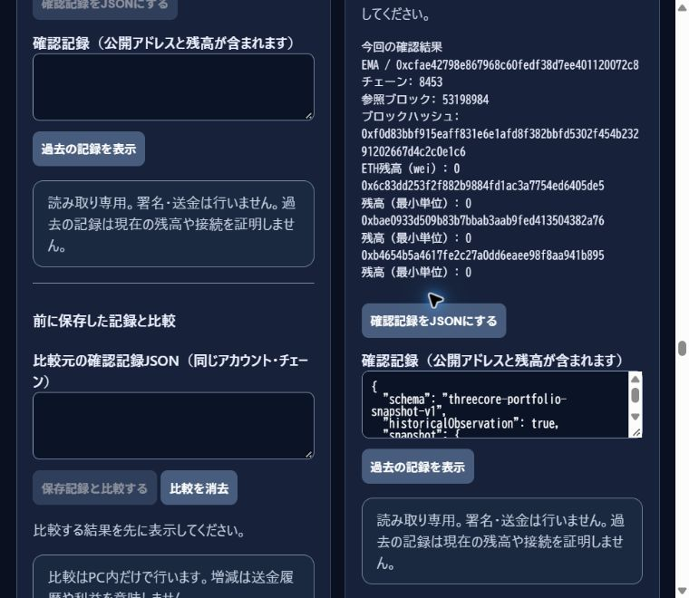

# ThreeCore read only verification 28 October 2026

This report records a completed read-only investigation of the designated Account 2 wallet on Base Mainnet. It connects each reported number to the saved data and gives readers an offline verification command.

Account: `0xcfae42798e867968c60fedf38d7ee401120072c8`. Chain ID: `8453`.
Historical cutoff: **53,198,900**, at **2026-10-28 11:32:27 UTC**. Balance comparison block: **53,198,984**.

The saved receiving-history responses contain **0 incoming transfers** for each of DAT, EMA and CAWELON within the stated ranges. The independently compared token and ETH balances are **0** at the stated balance block. These observations apply to this wallet and these contracts.

| Token | Contract | Deployment block | End block | Inclusive blocks | Received events |
|---|---|---:|---:|---:|---:|
| DAT | `0x6c83dd253f2f882b9884fd1ac3a7754ed6405de5` | 51,281,431 | 53,198,900 | 1,917,470 | 0 |
| EMA | `0xbae0933d509b83b7bbab3aab9fed413504382a76` | 51,542,489 | 53,198,900 | 1,656,412 | 0 |
| CAWELON | `0xb4654b5a4617fe2c27a0dd6eaee98f8aa941b895` | 51,542,494 | 53,198,900 | 1,656,407 | 0 |

The largest span is **1,917,470 blocks**. The token periods overlap; the headline figure describes the longest period.

## Chrome recovery

The local ThreeCore service had stopped while Chrome still held the loaded page. Restarting the matching service restored read-only history reads. No application source change was made during this recovery. Saved JSON was reopened through the existing file chooser, preview and apply workflow.

Evidence: [chrome-recovery.json](chrome-recovery.json).

## Chrome 20000 block pass

For each of DAT, EMA and CAWELON, blocks 53,025,243 through 53,045,242 were read in ten 2,000-block windows. The pass produced 30 on-screen observations and 60 downloaded result files: 30 JSON and 30 text summaries.

Evidence: [chrome-20000-summary.json](chrome-20000-summary.json).

## Historical coverage

Incoming Transfer logs were requested from token deployment through block 53,198,900, using 39 contiguous ranges of up to 50,000 blocks. The receiving-history queries for the designated account returned zero events for all three tokens. Blockscout recipient-and-token-filtered listings returned zero items and no next page.

Evidence: [result.json](result.json).

## Positive controls

Known Transfer events in the three deployment transactions were retrieved and compared with their transaction receipts. Additional controls used the same three-address array and recipient-topic filter shape as the historical scan. All three recipient-filter controls returned the expected known event.

Evidence: [supplemental-rpc-evidence.json](supplemental-rpc-evidence.json).

## Chrome cross checks

Six 2,000-block windows were checked in Chrome: one beginning at deployment and one ending at block 53,198,900 for each token. All returned zero events. Their JSON checksums and companion text summaries were checked.

Evidence: [chrome-history-checks.json](chrome-history-checks.json).

## Same block balances

At block 53,198,984, Chrome read zero DAT, EMA and CAWELON balances, together with a zero ETH balance. PublicNode reads at the same block returned the same balances and block hash.

Evidence: [chrome-portfolio.json](chrome-portfolio.json).

## Saved evidence

The folder contains the request parameters and returned data, Chrome observations and downloaded records, the balance screenshot, and integrity checksums. The local EMA history was updated to five records and a fresh local workspace backup was saved. Full wallet histories and workspace backups are excluded from this publication package because they include records outside this investigation.

Evidence: [final-verification.json](final-verification.json).

## Public source code

The running checkout was commit [`b1cf96c4bb3905f9336d9ef93110ebc4db43ef61`](https://github.com/FordPerfect2027/ThreeCore-Wallet/commit/b1cf96c4bb3905f9336d9ef93110ebc4db43ef61). These existing public links explain the implementation; the observations for this investigation are the files in this folder.

- [Base Mainnet state-read fix, PR 2](https://github.com/FordPerfect2027/ThreeCore-Wallet/pull/2)
- [Bounded transfer-history routing fix, PR 3](https://github.com/FordPerfect2027/ThreeCore-Wallet/pull/3)
- [Transfer history, saving and reloading](https://github.com/FordPerfect2027/ThreeCore-Wallet/blob/b1cf96c4bb3905f9336d9ef93110ebc4db43ef61/docs/transfer-history.md)
- [Token identity and exact balances](https://github.com/FordPerfect2027/ThreeCore-Wallet/blob/b1cf96c4bb3905f9336d9ef93110ebc4db43ef61/docs/TOKEN_IDENTITY_LOCAL_2026-10-23.md)

## Check the saved evidence

Download this folder, enter it in a terminal, and run with Node.js:

```text
node verify-evidence.mjs
```

The offline verifier checks every listed file checksum, all 39 requested range boundaries and recipient filters, the reported zero-event results, the 30-read/60-file Chrome batch, the six Chrome cross-check files, and the saved three-token balance record. It performs no network requests and uses no wallet.

To repeat a historical RPC query independently, inspect any `request-*.json` file with method `eth_getLogs`. Its `request.params` contains the exact contracts, block range and recipient topic. An archive-capable Base endpoint may impose different query limits. The supplemental evidence includes known nonempty control queries.

## Scope and limits

No signing, fund transfers, approval changes, private-key reads or wallet-security setting changes were performed. The procedure does not establish token safety, wallet ownership or absolute provider completeness. Zero results mean the specified reads returned no matching events. The fixed historical scope ends at block 53,198,900; later blocks are outside that scan.

Checksums detect changes relative to this package. They do not authenticate an RPC provider or establish that externally published records cannot have been edited. The local recovery details and screenshots are recorded observations, not independently witnessed attestations.


